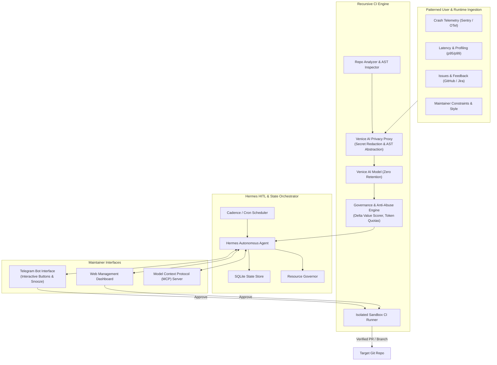
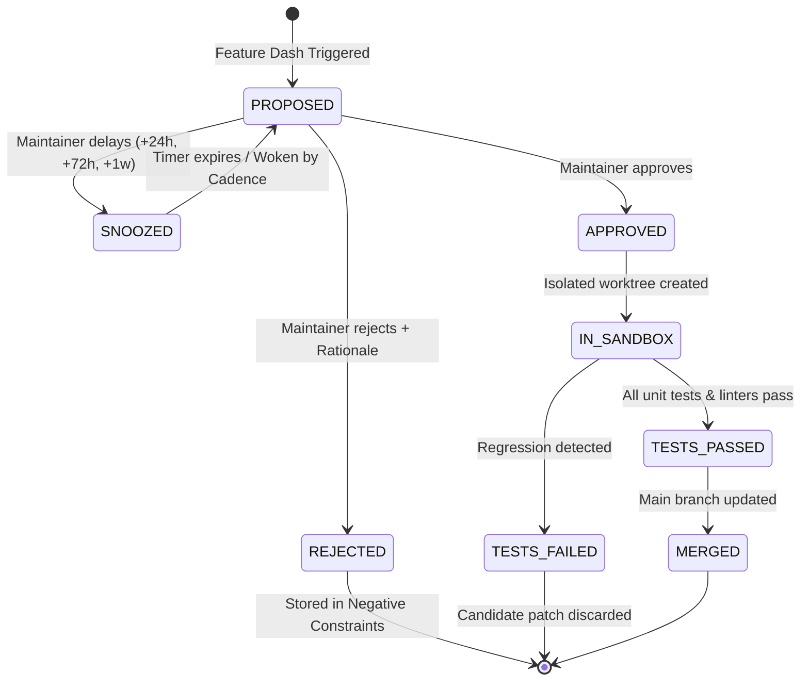

# Architecture Specification: Recursive Agentic Continuous Integration (HITL)

## 1. Executive Overview

The **Recursive Agentic Continuous Integration (HITL)** system creates an autonomous, self-evolving development loop for software repositories. Rather than relying on humans to manually inspect code for missing features or debt, an autonomous **Hermes Agent** continuously analyzes repositories, formulates structured enhancement batches ("Feature Dashes"), injects controlled mutation bugs to verify CI resilience, and presents interactive gates to human maintainers over **Telegram** and a dedicated **Web Management Dashboard**.

All code analysis and planning operates under a strict **Venice AI Privacy Boundary**, ensuring that zero proprietary code, credentials, or personal data persist on third-party servers.

---

## 2. Core System Components

---

## 3. Proposal Lifecycle State Machine

Each proposed improvement travels through a verifiable finite state machine:

---

## 4. Venice AI Privacy Model

To protect enterprise codebases and user data:
1. **Local Pre-Processing**: All candidate code chunks pass through `VenicePrivacyProxy` locally before dispatch.
2. **Secret & PII Redaction**: Regular expressions and AST tokenizers strip API keys (`sk-...`, `ghp_...`, `AIza...`), passwords, emails, and internal IP addresses.
3. **AST Semantic Abstraction**: Rather than transmitting raw proprietary files, the proxy extracts public function signatures, class interfaces, and structural contracts.
4. **Zero-Retention Guarantee**: Venice AI API calls are flagged with `X-Venice-Zero-Retention: true` and `include_venice_system_prompt: false`, ensuring requests are neither logged nor used for model training.

---

## 5. Anti-Abuse & Anti-Gamification Heuristics

To prevent bot runaway and vanity commit spam:
- **Daily Quotas**: Strict limits on daily proposals (default: 5/day) and daily token consumption (default: 250,000 tokens).
- **Semantic Delta Scorer**: Analyzes proposed diffs for whitespace churn, cosmetic comment modifications, or trivial renaming, rejecting proposals that fall below a `0.45` threshold.
- **Circuit Breakers**: Tripped automatically if 3 consecutive proposals for a repository are rejected by maintainers, entering a 7-day cooldown.
- **Isolated Sandbox Pass**: No code is ever marked ready for merge without achieving a 100% pass rate in a hermetic sandbox runner.
